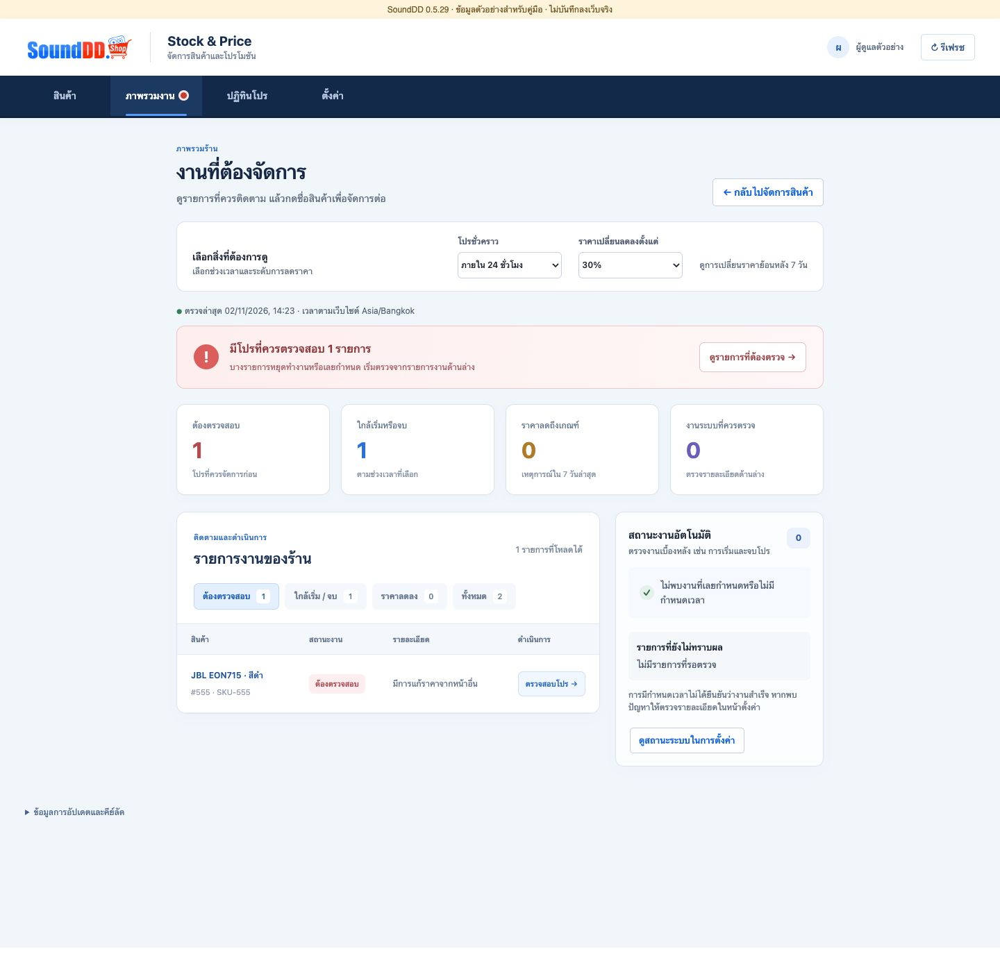
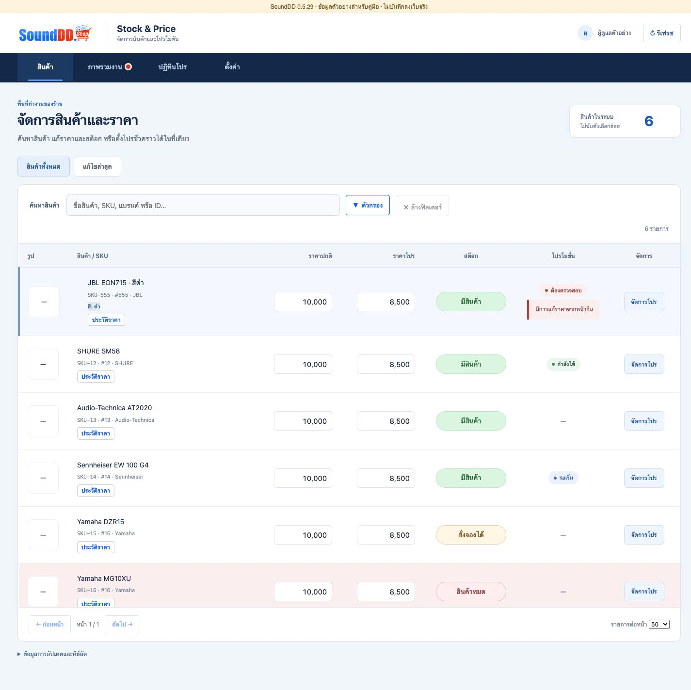
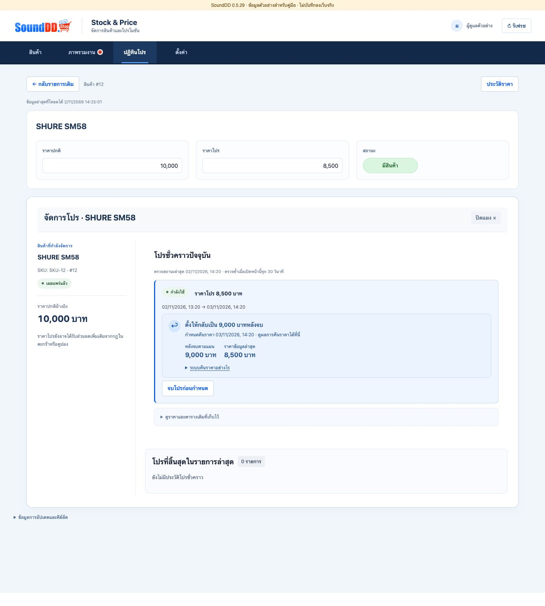
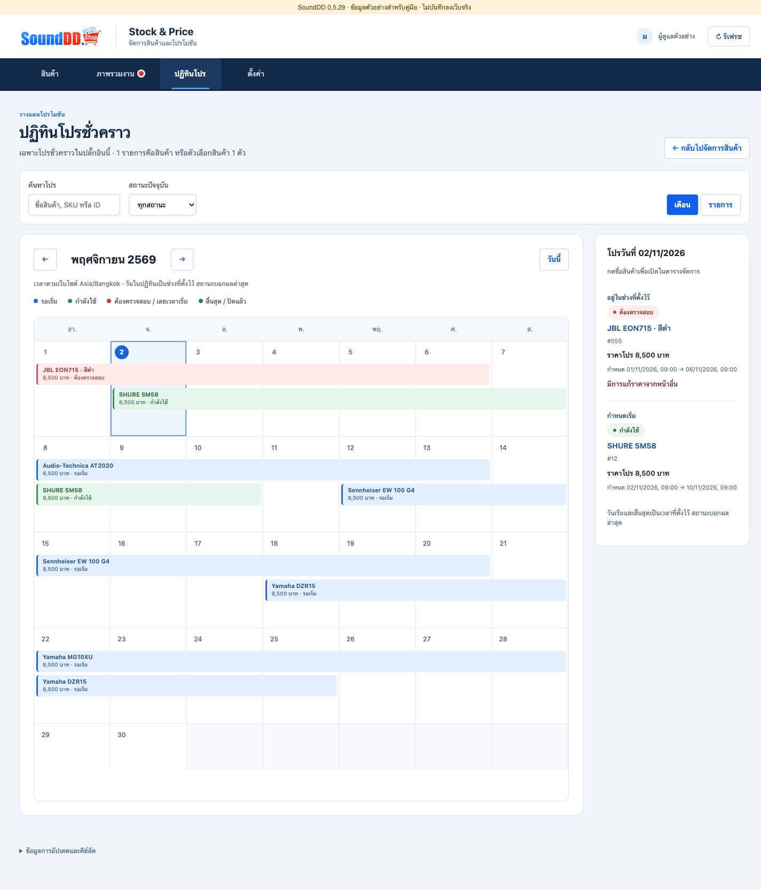
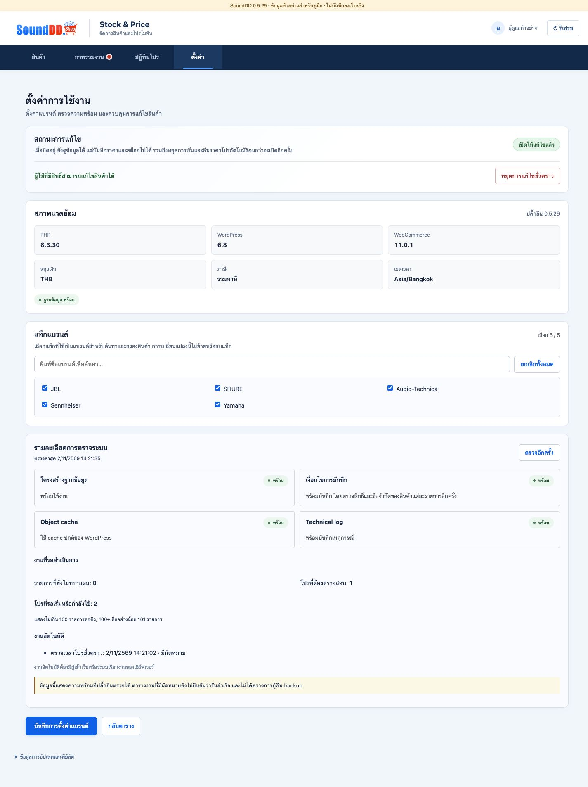

# SoundDD Stock & Price

รุ่นปัจจุบัน **0.5.29** — โปรชั่วคราวเก็บราคาและตารางเดิมไว้เพื่อคืนหลังจบ แสดงแผนคืนราคาและผลที่ระบบบันทึกจริงแยกกัน การทำงานตรงเวลาขึ้นกับงานอัตโนมัติของเว็บและข้อมูลราคาที่ไม่ถูกแก้แทรก

ปลั๊กอินสำหรับผู้ดูแลร้าน SoundDD ใช้จัดการราคาสินค้า ราคาโปร และสถานะสต็อกของ WooCommerce จากหน้าเดียว รองรับการตั้งโปรชั่วคราว ดูประวัติการแก้ไข และตรวจสอบรายการที่ต้องติดตาม

## ภาพหน้าจอรุ่น 0.5.29

ภาพต่อไปนี้ถ่ายจาก UI ของรุ่น **0.5.29** ที่รันในเบราว์เซอร์ด้วยโค้ด JavaScript/CSS ของปลั๊กอินจริงและ API ข้อมูลตัวอย่างใน Local ไม่ใช่ภาพออกแบบที่เจนขึ้น ชื่อสินค้า ราคา สถานะ และข้อมูลสภาพแวดล้อมในภาพมีไว้สาธิต ไม่ใช่ข้อมูลหรือผลตรวจระบบของร้านจริง

### ภาพรวมงานที่ต้องจัดการ

ดูโปรที่ต้องตรวจสอบ งานใกล้เริ่ม/จบ และสถานะงานอัตโนมัติ พร้อมเปิดสินค้าที่เกี่ยวข้องจากตารางงาน

### จัดการสินค้า ราคา และสต็อก

ค้นหาและกรองสินค้า แก้ราคา สต็อก หรือเปิดจัดการโปรจากแถวสินค้า การเปลี่ยนสต็อกต้องกดบันทึกก่อนมีผล

### แผนคืนราคาหลังจบโปรชั่วคราว

แยกราคาโปรที่ใช้อยู่ ราคาหลังจบตามแผน และเวลาที่ตั้งให้คืนราคา ในตัวอย่างนี้ใช้ราคาโปร 8,500 บาท และตั้งให้กลับเป็น 9,000 บาทหลังจบ ข้อความนี้เป็นแผน ยังไม่ได้หมายความว่าคืนราคาสำเร็จแล้ว

### ปฏิทินโปรชั่วคราว

แถบโปรแสดงช่วงวันต่อเนื่องข้ามสัปดาห์ ค้นหาและกรองสถานะได้ เลือกวันเพื่อดูรายละเอียดสินค้าและราคา

### ตั้งค่าและตรวจความพร้อมของระบบ

เลือกแบรนด์ ควบคุมการแก้ไข และดูสถานะระบบ ภาพนี้แสดงค่าจำลองสำหรับอธิบายหน้าจอ ไม่ใช่หลักฐานยืนยันความพร้อมของ production

ดู [รายละเอียดที่มาของภาพ](docs/screenshots/0.5.29/README.md) ภาพความละเอียดเต็มเปิดได้จากไฟล์แต่ละรูป

## ฟังก์ชันหลัก

- ค้นหาสินค้าด้วยชื่อ, SKU, ID หรือแบรนด์ และกรองตามสต็อก สถานะโปร หรือบทความโปรโมชัน
- แก้ราคาปกติ ราคาโปร และสถานะสต็อกของสินค้าที่รองรับ พร้อมตรวจสอบและยืนยันก่อนบันทึก
- ตั้งโปรชั่วคราวด้วยวันและเวลาที่กำหนด พร้อมดูสรุปราคาก่อนยืนยัน
- ดูรายการแก้ไขล่าสุด ประวัติโปร และชื่อบัญชีกับอีเมลของผู้ดำเนินการ
- ตรวจสอบบันทึกเหตุการณ์และดาวน์โหลด CSV สำหรับผู้ที่มีสิทธิ์
- ตรวจรุ่นเสถียรจาก GitHub Release และอัปเดตปลั๊กอินผ่านหน้า WordPress

## ข้อกำหนดระบบ

- WordPress 6.8 ขึ้นไป
- PHP 8.2 ขึ้นไป
- WooCommerce 10.0 ขึ้นไป

## สิทธิ์การใช้งาน

ผู้ดูแลระบบและผู้จัดการร้านสามารถเปิดหน้า **สต็อก & ราคา** และใช้ความสามารถจัดการสินค้า ราคา โปรชั่วคราว และดูประวัติได้ โดยการแก้ไขแต่ละสินค้ายังตรวจสิทธิ์สินค้าใน WooCommerce ตามปกติ ส่วนบันทึกเหตุการณ์ทางเทคนิคจำกัดไว้สำหรับผู้ดูแลระบบ

## ติดตั้งหรืออัปเดต

1. สำรองไฟล์เว็บไซต์และฐานข้อมูลก่อนติดตั้งหรืออัปเดตทุกครั้ง
2. ดาวน์โหลดไฟล์ ZIP รุ่นล่าสุดจาก [หน้า Release ของ SoundDD Stock & Price](https://github.com/InsightX-th/SDD-Price-Management/releases)
3. ใน WordPress ไปที่ **ปลั๊กอิน → เพิ่มปลั๊กอินใหม่ → อัปโหลดปลั๊กอิน** เลือกไฟล์ ZIP แล้วติดตั้ง
4. หลังอัปเดต ให้ตรวจหน้า **ปลั๊กอิน** ว่าเปิดใช้งานอยู่ และตรวจหน้า **สต็อก & ราคา** ว่าใช้งานได้

เมื่อมีรุ่นเสถียรใหม่ WordPress จะแสดงรายการอัปเดตในหน้า **ปลั๊กอิน** และ **แดชบอร์ด → อัปเดต** ผู้ดูแลเลือกอัปเดตได้จากหน้านั้น หากต้องการให้ WordPress ติดตั้งรุ่นใหม่เอง ให้เปิด **เปิดใช้งานการอัปเดตอัตโนมัติ** ที่แถวปลั๊กอิน การอัปเดตใช้ Release ล่าสุดที่เผยแพร่เป็นรุ่นปกติ ไม่ใช้รุ่นทดสอบหรือฉบับร่าง

ตั้งแต่รุ่น 0.5.27 ผู้ดูแลที่มีสิทธิ์อัปเดตปลั๊กอินกด **ตรวจสอบอัปเดต** ใต้ชื่อ SoundDD ในหน้า **ปลั๊กอิน** ได้โดยตรง ระบบจะตรวจ GitHub ใหม่โดยข้ามแคชเดิม และแจ้งว่าพบรุ่นใหม่ เป็นรุ่นล่าสุดแล้ว หรือยังตรวจสอบไม่ได้ หากมีรุ่นใหม่ ให้กด **อัปเดตตอนนี้** ใต้ชื่อปลั๊กอินได้ตามปกติ ปุ่ม **ตรวจสอบอีกครั้ง** ในหน้า **แดชบอร์ด → อัปเดต** จะตรวจ SoundDD ใหม่เช่นกัน

หากยังใช้รุ่นเก่าและไม่เห็นลิงก์ตรวจสอบอัปเดต ให้ลอง **แดชบอร์ด → อัปเดต → ตรวจสอบอีกครั้ง** ก่อน แคชของรุ่นเดิมอาจยังคงอยู่ หากต้องการรุ่นใหม่ทันที ให้อัปโหลด ZIP ทับรุ่นเดิมหนึ่งครั้ง หลังจากนั้นจะมีลิงก์ตรวจสอบอัปเดตให้ใช้ การตรวจรุ่นและดาวน์โหลดอาศัย HTTPS จากเซิร์ฟเวอร์ WordPress ไปยัง GitHub; หากเชื่อมต่อไม่ได้ ระบบจะแจ้งปัญหาและยังอัปเดตด้วย ZIP ได้ตามขั้นตอนด้านบน

## งานที่ต้องจัดการ

ผู้ดูแลระบบและผู้จัดการร้านเปิด **ภาพรวมงาน** จากแถบด้านบน เพื่อดูโปรชั่วคราวที่ต้องตรวจสอบหรือใกล้เริ่ม/จบ ราคาที่ลดลงตามเกณฑ์จากประวัติ 7 วัน และงานอัตโนมัติที่เลยกำหนดหรือไม่มีนัดหมาย กดชื่อสินค้าหรือปุ่มตรวจสอบเพื่อเปิดพื้นที่แก้ไขสินค้านั้นโดยตรง รวมถึงตัวเลือกย่อย โดยกลับรายการเดิมได้ เลือกช่วงโปร 24 ชั่วโมงหรือ 7 วัน และเกณฑ์ราคาลดลง 10%, 20%, 30% หรือ 50% ได้

แต่ละรายการสินค้าแสดงผลจากข้อมูลที่ตรวจได้สูงสุด 100 แถวแรก พร้อมแจ้งเมื่อมีรายการเพิ่มเติม สถานะงานอัตโนมัติแสดงตามเวลานัดหมายและไม่ยืนยันผลการทำงาน รายการโปรอ้างอิงโปรชั่วคราวของปลั๊กอิน

## ปฏิทินและการแจ้งเตือนโปรชั่วคราว

กด **ปฏิทินโปร** ที่แถบด้านบนเพื่อดูโปรตามเดือน เลือกวันเพื่อดูสินค้า ราคา ช่วงเวลาที่ตั้งไว้ และสถานะล่าสุด โปรแสดงเป็นแถบต่อเนื่องตามวันที่ตั้งไว้ ค้นหาด้วยชื่อ SKU หรือ ID และกรองสถานะปัจจุบันได้ สลับมุมมองเดือน/รายการได้ บนมือถือแสดงเป็นรายการ กดชื่อสินค้าเพื่อเปิดพื้นที่แก้ไขโดยตรง เวลาทั้งหมดใช้เขตเวลาของเว็บไซต์ ปฏิทินแสดงสูงสุด 200 รายการแรกในเดือนที่เลือกและแจ้งเมื่อมีรายการเพิ่มเติม

เมื่อเปิดหน้าปลั๊กอิน ระบบตรวจโปรที่ต้องตรวจสอบหรือเลยกำหนดเป็นระยะ หากพบจะแสดงจุดแจ้งเตือนบนเมนู **ภาพรวมงาน** กดปุ่มเพื่อดูรายการและเหตุผล หากตรวจไม่ได้จะแสดงเครื่องหมายเตือน การแจ้งเตือนนี้อยู่ภายในหน้าปลั๊กอินและไม่ได้ส่งอีเมล

## ตั้งค่าครั้งแรก

1. เปิด **สต็อก & ราคา → ตั้งค่า**
2. เลือกแท็กสินค้าที่ใช้เป็นแบรนด์ ใช้ช่องค้นหาเพื่อหาแท็ก และเลือกทั้งหมดเฉพาะรายการที่กำลังแสดงได้
3. ตรวจสถานะระบบและอ่านเงื่อนไขการแก้ไขสินค้า
4. ยืนยันว่ามีข้อมูลสำรองที่กู้คืนได้ แล้วกด **เปิดให้แก้ไขสินค้า**

การเลือกแท็กแบรนด์ใช้สำหรับค้นหาและกรองเท่านั้น ไม่ย้ายหรือลบแท็กใน WooCommerce

## แก้ราคาและสต็อก

ค้นหาสินค้าแล้วเลือกช่องราคาหรือสต็อกที่ต้องการแก้ จากนั้นกด **บันทึก** การเปลี่ยนสต็อกยังไม่มีผลจนกว่าจะกดบันทึก ส่วนราคามีหน้าต่างแสดงค่าก่อนและหลังให้ยืนยันอีกครั้ง ราคาใช้จำนวนเต็มบาท ไม่มีทศนิยม และจัดรูปแบบตัวเลขให้อ่านง่าย เช่น `12,900`

การแก้สต็อกเปลี่ยนเฉพาะสถานะ **มีสินค้า**, **สินค้าหมด** หรือ **สินค้าสั่งจอง** ไม่ได้เปลี่ยนจำนวนสินค้า การตั้งค่าจัดการจำนวน หรือการอนุญาตให้สั่งจอง

สินค้าตัวแปรแสดงราคาและสต็อกรวมที่แถวสินค้าหลัก กด **ดูตัวเลือก** เพื่อแก้ไขสินค้าแต่ละตัวเลือก สินค้าชนิดอื่นที่ยังไม่รองรับจะแสดงเหตุผลและเปิดให้อ่านอย่างเดียว

## ตั้งโปรชั่วคราว

1. กด **จัดการโปร** ที่สินค้า
2. กรอกราคาและวันเวลาเริ่ม/สิ้นสุดตามเขตเวลาของเว็บไซต์ โดยเวลาสิ้นสุดเริ่มต้นเป็น 23:59 และเปลี่ยนเวลาได้
3. ตรวจราคาก่อนเริ่มตามตารางเดิม ราคาช่วงโปร และราคาหลังจบตามแผน ราคาปกติยังเป็นราคาอ้างอิงสำหรับตรวจสอบราคาโปร ระบบเตือนหากราคาใหม่สูงกว่าราคาก่อนเริ่มตามตารางเดิม
4. หากต้องการให้ราคาโปรเดิมใช้ต่อแม้วันสิ้นสุดเดิมผ่านไปแล้ว ให้เลือกช่องตัวเลือกดังกล่าว
5. กด **ยืนยันตั้งโปรชั่วคราว**

ระบบใช้ราคาปกติเป็นราคาอ้างอิงเสมอเมื่อตั้งและแสดงโปรชั่วคราว ไม่ว่ามีราคาโปรเดิมหรือไม่ เมื่อโปรชั่วคราวจบ ระบบจะพยายามคืนราคาโปรเดิมและตารางเดิม หากโปรเดิมหมดอายุแล้ว ระบบจะกลับไปใช้ราคาปกติเว้นแต่ผู้ดูแลเลือกให้ใช้ราคาโปรเดิมต่อ

การเริ่มและคืนราคาตรงเวลาขึ้นกับงานอัตโนมัติของ WordPress และระบบเรียกงานของเซิร์ฟเวอร์ หากมีการแก้ราคา/วันโปรระหว่างโปรชั่วคราว ระบบจะหยุดคืนราคาอัตโนมัติและแสดงสถานะ **ต้องตรวจสอบ** เพื่อป้องกันการเขียนทับการแก้ไขใหม่

## แผนและผลการคืนราคา

- **ก่อนและระหว่างโปร:** แสดงจำนวนเงินที่จะใช้หลังจบตามแผน พร้อมกำหนดคืนราคา รายละเอียดเงื่อนไขพับไว้ให้เปิดอ่านได้
- **คืนราคาแล้ว:** ระบบบันทึกการคืนราคาและตารางเดิมสำเร็จ แสดงเวลาเปลี่ยนสถานะ และแยกราคาที่อ่านได้ปัจจุบันออกจากแผนเดิม ราคาปัจจุบันอาจถูกแก้ภายหลังได้
- **ต้องตรวจสอบ / เลยเวลาคืน / งานหยุดอยู่:** ยังไม่ยืนยันการคืนอัตโนมัติ ให้ตรวจราคาปัจจุบันและประวัติ หรือติดต่อผู้ดูแลตามสาเหตุ

เมื่อเปิดแผงโปรและหน้ายังมองเห็นอยู่ จะตรวจสถานะซ้ำทุก 30 วินาที พร้อมเวลาที่อ่านข้อมูลล่าสุด การตรวจซ้ำนี้เป็นการอ่านข้อมูล ไม่ใช่ตัวเรียกงานเริ่มหรือคืนราคา

ปุ่ม **ยกเลิกโปรที่รอเริ่ม** ไม่เปลี่ยนราคาปัจจุบัน ส่วน **จบโปรก่อนกำหนด** จะพยายามคืนราคาเมื่อข้อมูลยังตรงกัน ปุ่ม **ปิดรายการและคงราคาปัจจุบัน** สำหรับรายการที่ต้องตรวจสอบจะไม่คืนราคาให้ ข้อความยืนยันจะระบุผลของการกดแต่ละปุ่ม

การกด **หยุดการแก้ไขชั่วคราว** ในตั้งค่า หยุดทั้งการบันทึกของผู้ใช้และการเริ่ม/คืนราคาโปรอัตโนมัติ จนกว่าจะเปิดการแก้ไขอีกครั้ง

## ทำงานต่อจากจุดเดิม

หน้า ตัวกรอง เดือนปฏิทิน และสินค้าที่เปิดเก็บอยู่ใน URL จึงรีโหลด กด Back หรือคัดลอกลิงก์เพื่อเปิดบริบทเดียวกันได้ การเปิดลิงก์ยังตรวจสิทธิ์ผู้ใช้งานตามปกติ

ค่าค้างบันทึกและแบบร่างโปรจะแสดงในแถบแจ้ง พร้อมปุ่มกลับไปยังสินค้าและช่องนั้น ค่าที่ยังไม่บันทึกเก็บในหน่วยความจำของแท็บเท่านั้น ไม่ได้บันทึกใน URL และไม่คงอยู่หลังรีโหลดหรือปิดแท็บ หากมีข้อมูลค้าง ระบบจะเตือนก่อนออกจากหน้า

บนมือถือ รายการสินค้าแสดงเป็นการ์ดและเปิดแก้ทีละสินค้า บน Desktop ใช้ตารางและแผงจัดการโปร พร้อมหัวตารางที่ติดเมื่อเลื่อน

## ประวัติและบันทึกเหตุการณ์

แท็บ **แก้ไขล่าสุด** แสดงรายการที่เปลี่ยนราคาผ่านปลั๊กอินนี้ รวมการเริ่มและคืนโปรชั่วคราว ประวัติแสดงชื่อบัญชีและอีเมลตามข้อมูลผู้ใช้ใน WordPress ผู้ที่มีสิทธิ์ดูบันทึกเหตุการณ์สามารถกรองรายการและดาวน์โหลด CSV ได้

หากไม่แน่ใจว่าคำสั่งบันทึกสำเร็จหรือไม่ ให้ตรวจผลของคำสั่งเดิมก่อน อย่าส่งคำสั่งซ้ำจนกว่าจะทราบผล

## การดูแลเว็บไซต์

- ตรวจสุขภาพระบบและคิวงานอัตโนมัติจากหน้า **ตั้งค่า** เป็นระยะ
- ตรวจให้ WordPress Cron หรือระบบเรียกงานของเซิร์ฟเวอร์ทำงาน เพื่อให้โปรเริ่มและคืนราคาตามกำหนด
- ทดสอบกระบวนการสำรองและกู้คืนตามแผนดูแลร้าน ก่อนอัปเดตปลั๊กอินหรือเปลี่ยนการตั้งค่าราคา
- หน้าสุขภาพแสดงเฉพาะสิ่งที่ปลั๊กอินตรวจได้ สถานะงานที่มีนัดหมายไม่ได้ยืนยันว่ารันสำเร็จ และไม่แทนการทดสอบกู้คืน backup

## ขอบเขตการแก้ไข

สินค้าทั่วไปและตัวเลือกของสินค้าตัวแปรที่รองรับสามารถแก้ได้ตามสิทธิ์ของผู้ใช้ แถวสินค้าตัวแปรหลักเป็นข้อมูลสรุปเท่านั้น การเปลี่ยนราคาทุกครั้งต้องยืนยันและบันทึกผู้ดำเนินการ สินค้าที่ไม่ผ่านเงื่อนไขจะแสดงเหตุผลและไม่เปิดให้แก้ไข

## เปิดหน้าทิ้งไว้แล้วเชื่อมต่อไม่ได้

ระบบต่ออายุ nonce อัตโนมัติเมื่อ WordPress แจ้งว่าหมดอายุ หากยังเข้าสู่ระบบด้วยบัญชีเดิมอยู่ จะดำเนินคำขอเดิมต่อได้หนึ่งครั้ง หากเซิร์ฟเวอร์ปฏิเสธหรือส่งหน้า HTML กลับมา ระบบจะแสดงคำอธิบายและหยุดเรียกข้อมูลซ้ำ โดยเก็บค่าที่ยังไม่ได้บันทึกไว้ในแท็บเดิม

กด **เชื่อมต่อใหม่** เพื่อลองอีกครั้ง หากการเข้าสู่ระบบหมดอายุ ให้กด **เข้าสู่ระบบอีกแท็บ** แล้วกลับมากดเชื่อมต่อใหม่ หากเข้าสู่ระบบด้วยคนละบัญชี ให้เปิดหน้าปลั๊กอินใหม่ก่อนแก้ไขสินค้า

หากยังพบ HTTP 403 ให้ผู้ดูแลตรวจ response และบันทึกของเซิร์ฟเวอร์/CDN/ระบบป้องกันสำหรับ REST API และ admin-ajax.php ข้อความ HTTP 403 เพียงอย่างเดียวไม่ระบุสาเหตุแน่ชัด หากมีคำสั่งบันทึกที่ยังยืนยันผลไม่ได้ ให้ตรวจผลคำสั่งเดิมก่อนส่งใหม่

## การทดสอบสำหรับผู้พัฒนา

รัน `node --test tests/session-client.cjs tests/ui-layout.cjs` และตรวจ syntax ด้วย `node --check assets/app.js`

ไฟล์ `tests/local-*.php` ใช้ WP-CLI กับ Local สำหรับทดสอบเท่านั้น มี fixture ที่ rollback หลังจบ ห้ามนำไปรันบน production ดูผลการตรวจรุ่นนี้ที่ [รายงาน 0.5.29](docs/releases/0.5.29.md)
