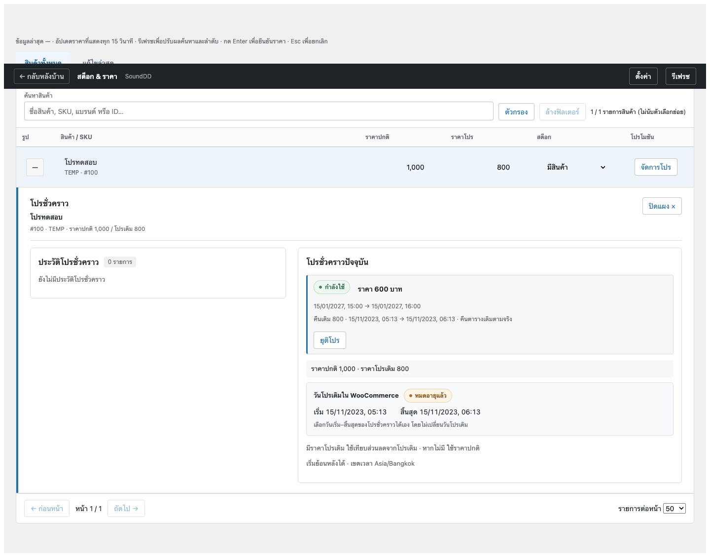
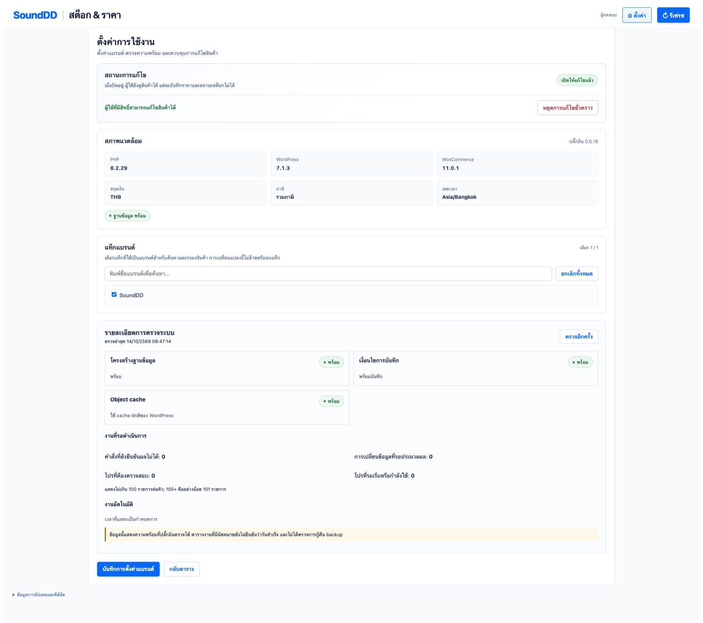

# SoundDD Stock & Price

ปลั๊กอินสำหรับผู้ดูแลร้าน SoundDD ใช้จัดการราคาสินค้า ราคาโปร และสถานะสต็อกของ WooCommerce จากหน้าเดียว รองรับการตั้งโปรชั่วคราว ดูประวัติการแก้ไข และตรวจสอบรายการที่ต้องติดตาม

## ตัวอย่างหน้าจอ

ภาพต่อไปนี้แสดงพื้นที่ทำงานจัดการสินค้าและโปรชั่วคราว รวมถึงหน้าตั้งค่าและตรวจความพร้อมของระบบ ข้อมูลสินค้าและเวลาที่เห็นในภาพเป็นข้อมูลตัวอย่างจาก Local สำหรับสาธิตการใช้งาน

### ตารางสินค้าและแผงจัดการโปร

### ตั้งค่าและตรวจความพร้อมของระบบ

## ฟังก์ชันหลัก

- ค้นหาสินค้าด้วยชื่อ, SKU, ID หรือแบรนด์ และกรองตามสต็อก สถานะโปร หรือบทความโปรโมชัน
- แก้ราคาปกติ ราคาโปร และสถานะสต็อกของสินค้าที่รองรับ พร้อมตรวจสอบและยืนยันก่อนบันทึก
- ตั้งโปรชั่วคราวด้วยวันและเวลาที่กำหนด พร้อมดูสรุปราคาก่อนยืนยัน
- ดูรายการแก้ไขล่าสุด ประวัติโปร และชื่อบัญชีกับอีเมลของผู้ดำเนินการ
- ตรวจสอบบันทึกเหตุการณ์และดาวน์โหลด CSV สำหรับผู้ที่มีสิทธิ์
- ตรวจรุ่นเสถียรจาก GitHub Release และอัปเดตปลั๊กอินผ่านหน้า WordPress

## ข้อกำหนดระบบ

- WordPress 6.8 ขึ้นไป
- PHP 8.2 ขึ้นไป
- WooCommerce 10.0 ขึ้นไป

## ติดตั้งหรืออัปเดต

1. สำรองไฟล์เว็บไซต์และฐานข้อมูลก่อนติดตั้งหรืออัปเดตทุกครั้ง
2. ดาวน์โหลดไฟล์ ZIP รุ่นล่าสุดจาก [หน้า Release ของ SoundDD Stock & Price](https://github.com/InsightX-th/SDD-Price-Management/releases)
3. ใน WordPress ไปที่ **ปลั๊กอิน → เพิ่มปลั๊กอินใหม่ → อัปโหลดปลั๊กอิน** เลือกไฟล์ ZIP แล้วติดตั้ง
4. หลังอัปเดต ให้ตรวจหน้า **ปลั๊กอิน** ว่าเปิดใช้งานอยู่ และตรวจหน้า **สต็อก & ราคา** ว่าใช้งานได้

เมื่อมีรุ่นเสถียรใหม่ WordPress จะแสดงรายการอัปเดตในหน้า **ปลั๊กอิน** และ **แดชบอร์ด → อัปเดต** ผู้ดูแลเลือกอัปเดตได้จากหน้านั้น หากต้องการให้ WordPress ติดตั้งรุ่นใหม่เอง ให้เปิด **เปิดใช้งานการอัปเดตอัตโนมัติ** ที่แถวปลั๊กอิน การอัปเดตใช้ Release ล่าสุดที่เผยแพร่เป็นรุ่นปกติ ไม่ใช้รุ่นทดสอบหรือฉบับร่าง

หากหน้าอัปเดตยังไม่แสดงรุ่นใหม่ ให้กด **ตรวจสอบอีกครั้ง** ในหน้า **แดชบอร์ด → อัปเดต** การตรวจรุ่นอาศัยการเชื่อมต่อ HTTPS จากเซิร์ฟเวอร์ WordPress ไปยัง GitHub; หากเซิร์ฟเวอร์ออกอินเทอร์เน็ตไม่ได้ ยังติดตั้งหรืออัปเดตด้วยไฟล์ ZIP ได้ตามขั้นตอนด้านบน

## ตั้งค่าครั้งแรก

1. เปิด **สต็อก & ราคา → ตั้งค่า**
2. เลือกแท็กสินค้าที่ใช้เป็นแบรนด์ ใช้ช่องค้นหาเพื่อหาแท็ก และเลือกทั้งหมดเฉพาะรายการที่กำลังแสดงได้
3. ตรวจสถานะระบบและอ่านเงื่อนไขการแก้ไขสินค้า
4. ยืนยันว่ามีข้อมูลสำรองที่กู้คืนได้ แล้วกด **เปิดให้แก้ไขสินค้า**

การเลือกแท็กแบรนด์ใช้สำหรับค้นหาและกรองเท่านั้น ไม่ย้ายหรือลบแท็กใน WooCommerce

## แก้ราคาและสต็อก

ค้นหาสินค้าแล้วเลือกช่องราคาหรือสต็อกที่ต้องการแก้ ระบบจะแสดงค่าก่อนและหลัง พร้อมให้ยืนยันก่อนบันทึก ราคาใช้จำนวนเต็มบาท ไม่มีทศนิยม และจัดรูปแบบตัวเลขให้อ่านง่าย เช่น `12,900`

การแก้สต็อกเปลี่ยนเฉพาะสถานะ **มีสินค้า**, **สินค้าหมด** หรือ **สินค้าสั่งจอง** ไม่ได้เปลี่ยนจำนวนสินค้า การตั้งค่าจัดการจำนวน หรือการอนุญาตให้สั่งจอง

สินค้าตัวแปรแสดงราคาและสต็อกรวมที่แถวสินค้าหลัก กด **ดูตัวเลือก** เพื่อแก้ไขสินค้าแต่ละตัวเลือก สินค้าชนิดอื่นที่ยังไม่รองรับจะแสดงเหตุผลและเปิดให้อ่านอย่างเดียว

## ตั้งโปรชั่วคราว

1. กด **จัดการโปร** ที่สินค้า
2. กรอกราคาและวันเวลาเริ่ม/สิ้นสุดตามเขตเวลาของเว็บไซต์
3. ตรวจราคาอ้างอิง ราคาช่วงโปร และราคาหลังจบโปรในสรุปก่อนยืนยัน
4. หากต้องการให้ราคาโปรเดิมใช้ต่อแม้วันสิ้นสุดเดิมผ่านไปแล้ว ให้เลือกช่องตัวเลือกดังกล่าว
5. กด **ยืนยันตั้งโปรชั่วคราว**

เมื่อมีราคาโปรเดิม ระบบใช้ราคานั้นเป็นราคาอ้างอิงก่อนเริ่มโปรชั่วคราว หากไม่มีราคาโปรเดิม ระบบใช้ราคาปกติ เมื่อโปรชั่วคราวจบ ระบบคืนราคาและตารางเดิมตามกำหนด หากโปรเดิมหมดอายุแล้ว ระบบจะกลับไปใช้ราคาปกติเว้นแต่ผู้ดูแลเลือกให้ใช้ราคาโปรเดิมต่อ

การเริ่มและคืนราคาตรงเวลาขึ้นกับงานอัตโนมัติของ WordPress และระบบเรียกงานของเซิร์ฟเวอร์ หากมีการแก้ราคา/วันโปรระหว่างโปรชั่วคราว ระบบจะหยุดคืนราคาอัตโนมัติและแสดงสถานะ **ต้องตรวจสอบ** เพื่อป้องกันการเขียนทับการแก้ไขใหม่

## ประวัติและบันทึกเหตุการณ์

แท็บ **แก้ไขล่าสุด** แสดงรายการที่เปลี่ยนราคาผ่านปลั๊กอินนี้ รวมการเริ่มและคืนโปรชั่วคราว ประวัติแสดงชื่อบัญชีและอีเมลตามข้อมูลผู้ใช้ใน WordPress ผู้ที่มีสิทธิ์ดูบันทึกเหตุการณ์สามารถกรองรายการและดาวน์โหลด CSV ได้

หากไม่แน่ใจว่าคำสั่งบันทึกสำเร็จหรือไม่ ให้ตรวจผลของคำสั่งเดิมก่อน อย่าส่งคำสั่งซ้ำจนกว่าจะทราบผล

## การดูแลเว็บไซต์

- ตรวจสุขภาพระบบและคิวงานอัตโนมัติจากหน้า **ตั้งค่า** เป็นระยะ
- ตรวจให้ WordPress Cron หรือระบบเรียกงานของเซิร์ฟเวอร์ทำงาน เพื่อให้โปรเริ่มและคืนราคาตามกำหนด
- ทดสอบกระบวนการสำรองและกู้คืนตามแผนดูแลร้าน ก่อนอัปเดตปลั๊กอินหรือเปลี่ยนการตั้งค่าราคา
- หน้าสุขภาพแสดงเฉพาะสิ่งที่ปลั๊กอินตรวจได้ สถานะงานที่มีนัดหมายไม่ได้ยืนยันว่ารันสำเร็จ และไม่แทนการทดสอบกู้คืน backup

## ขอบเขตการแก้ไข

สินค้าทั่วไปและตัวเลือกของสินค้าตัวแปรที่รองรับสามารถแก้ได้ตามสิทธิ์ของผู้ใช้ แถวสินค้าตัวแปรหลักเป็นข้อมูลสรุปเท่านั้น การเปลี่ยนราคาทุกครั้งต้องยืนยันและบันทึกผู้ดำเนินการ สินค้าที่ไม่ผ่านเงื่อนไขจะแสดงเหตุผลและไม่เปิดให้แก้ไข
