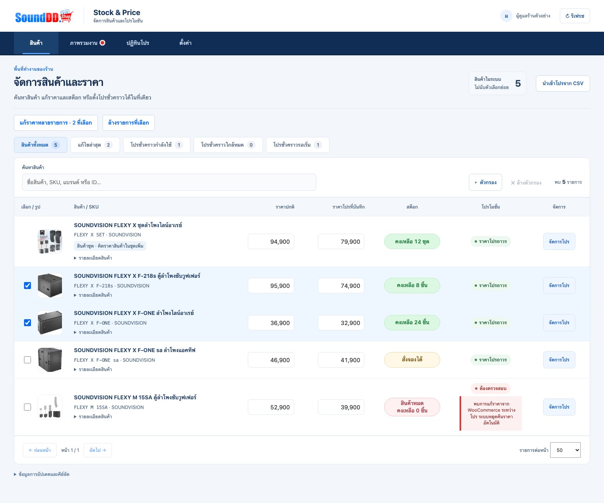
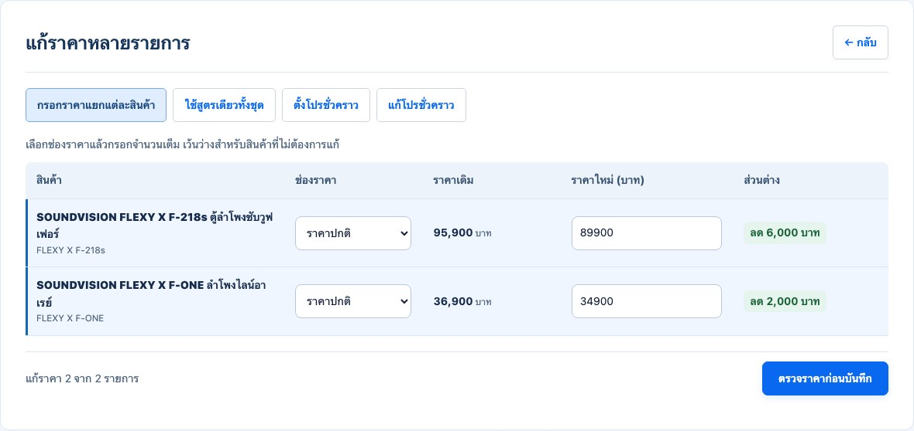
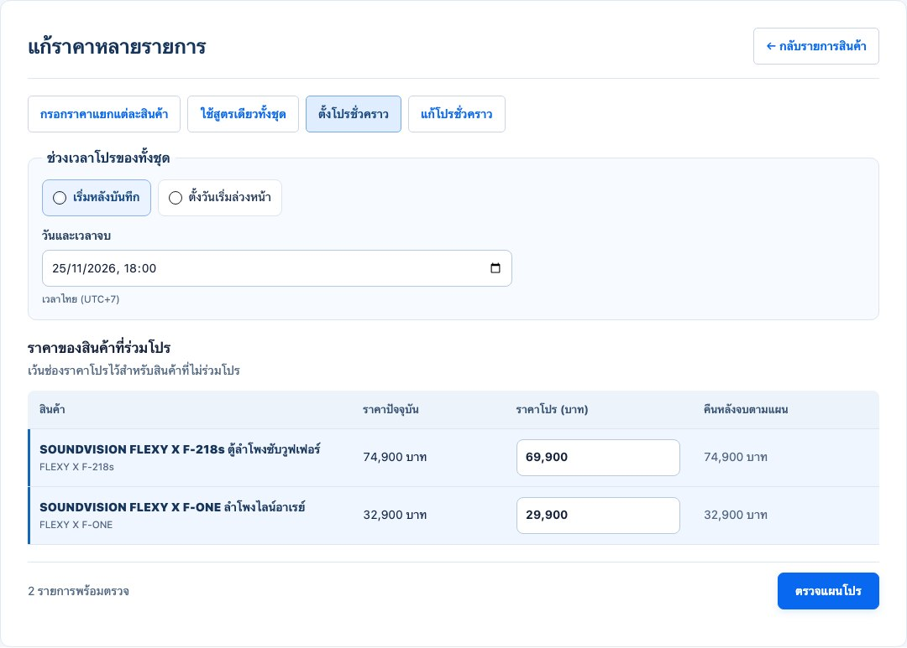
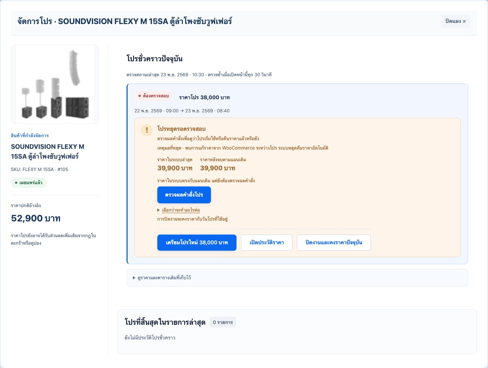
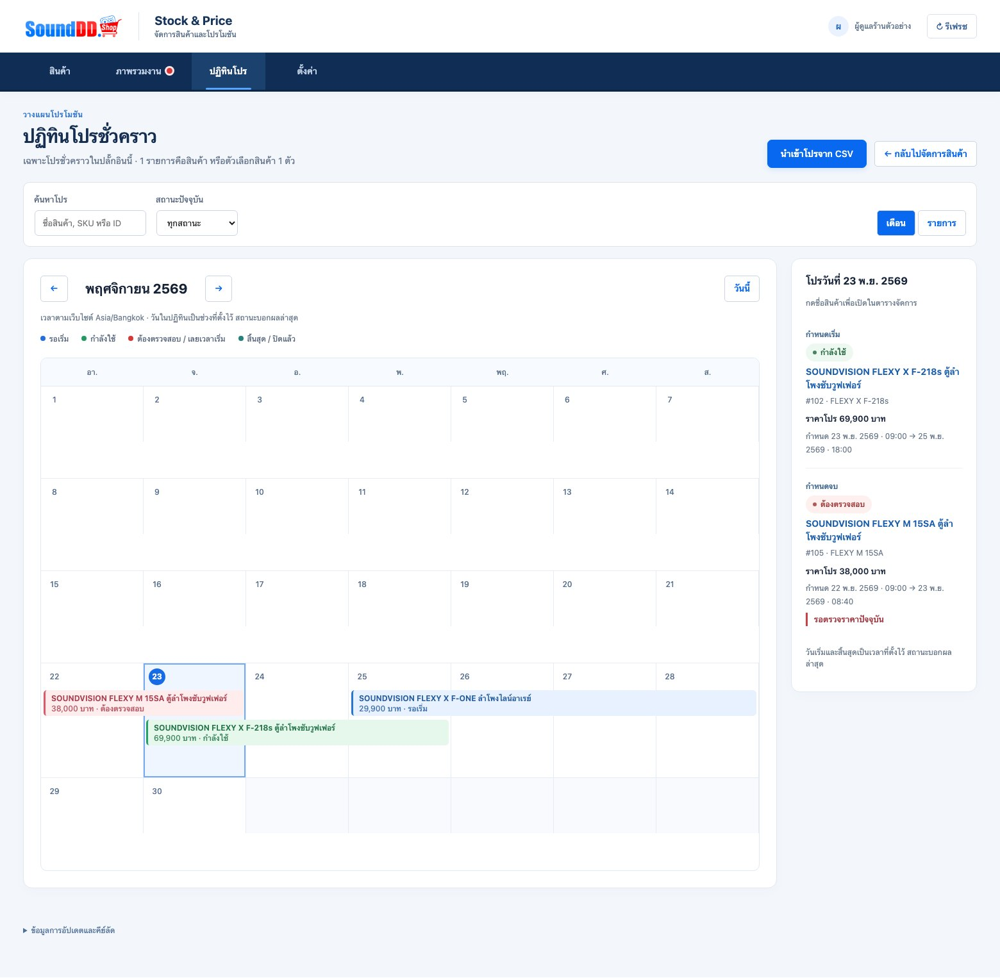

# SoundDD Stock & Price

รุ่น **0.6.0** เพิ่มการกรอกราคาแยกรายสินค้าและการตั้งโปรชั่วคราวหลายรายการ รองรับการแก้ราคาของสินค้าชุดใน WooCommerce Product Bundles และแสดงจำนวนคงเหลือเมื่อมีข้อมูลสต็อก ฟีเจอร์ Cloudflare ปิดไว้เป็นค่าเริ่มต้น

ปลั๊กอินสำหรับผู้ดูแลร้าน SoundDD ใช้จัดการราคาสินค้า ราคาโปร และสถานะสต็อกของ WooCommerce จากหน้าเดียว รองรับการตั้งโปรชั่วคราว ดูประวัติการแก้ไข และตรวจสอบรายการที่ต้องติดตาม

## ภาพหน้าจอรุ่น 0.6.0

ภาพถ่ายจากปลั๊กอินที่รันในเบราว์เซอร์ ชื่อสินค้า ราคา จำนวนคงเหลือ และสถานะโปรใช้ข้อมูลตัวอย่าง [รายละเอียดที่มาของภาพ](docs/screenshots/0.6.0/README.md)

### จัดการสินค้า ราคา และสต็อก

ติ๊กเลือกสินค้าจากตารางเพื่อแก้หลายรายการ สินค้าที่มีข้อมูลจำนวนจะแสดงยอดคงเหลือในป้ายสต็อก [ดูตัวอย่างบนมือถือ](docs/screenshots/0.6.0/catalog-mobile.jpg)

### กรอกราคาแยกแต่ละสินค้า

เลือกช่องราคาต่อสินค้า แล้วเปรียบเทียบราคาเดิม ราคาใหม่ และส่วนต่างก่อนส่งตรวจ

### ตั้งโปรชั่วคราวหลายรายการ

กำหนดช่วงเวลาเดียวกันทั้งชุด แล้วกรอกราคาโปรแยกแต่ละสินค้า พร้อมดูราคาหลังจบตามแผน

### ตรวจโปรที่หยุดคืนราคาอัตโนมัติ

เปิดแผงจัดการโปรเพื่อเปรียบเทียบราคาล่าสุดกับราคาตามแผน และตรวจผลคำสั่งก่อนปิดงานหรือเตรียมโปรใหม่

### ปฏิทินโปรชั่วคราว

ค้นหาโปร กรองสถานะ และเปิดสินค้าที่เกี่ยวข้องจากวันในปฏิทิน

## ฟังก์ชันหลัก

- ค้นหาสินค้าด้วยชื่อ, SKU, ID หรือแบรนด์ และกรองตามสต็อก สถานะโปร หรือบทความโปรโมชัน
- แก้ราคาปกติ ราคาโปร และสถานะสต็อกของสินค้าที่รองรับ พร้อมตรวจสอบและยืนยันก่อนบันทึก
- แก้ราคาหลายรายการด้วยการกรอกแยกรายสินค้า หรือใช้สูตรเพิ่ม/ลดแบบบาทหรือเปอร์เซ็นต์
- ตั้งโปรชั่วคราวทีละสินค้าหรือหลายรายการ พร้อมตรวจราคาและแผนคืนราคาก่อนยืนยัน
- ดูรายการแก้ไขล่าสุด ประวัติโปร และชื่อบัญชีกับอีเมลของผู้ดำเนินการ
- ตรวจสอบบันทึกเหตุการณ์และดาวน์โหลด CSV สำหรับผู้ที่มีสิทธิ์
- ตรวจรุ่นเสถียรจาก GitHub Release และอัปเดตปลั๊กอินผ่านหน้า WordPress

## ข้อกำหนดระบบ

- WordPress 6.8 ขึ้นไป
- PHP 8.2 ขึ้นไป
- WooCommerce 10.0 ขึ้นไป

## สิทธิ์การใช้งาน

ผู้ดูแลระบบและผู้จัดการร้านเข้าถึงหน้าสินค้าได้ตามสิทธิ์ที่ได้รับ การแก้สินค้าแต่ละรายการยังตรวจสิทธิ์ WooCommerce แยกกัน การแก้หลายรายการ ตั้งโปร ตรวจบันทึกทางเทคนิค และตั้งค่า Cloudflare ต้องใช้สิทธิ์ของเมนูนั้น หากปุ่มไม่ปรากฏ ให้ผู้ดูแลระบบตรวจสิทธิ์ของบัญชี

## ติดตั้งหรืออัปเดต

1. สำรองไฟล์เว็บไซต์และฐานข้อมูลก่อนติดตั้งหรืออัปเดตทุกครั้ง
2. ดาวน์โหลดไฟล์ ZIP รุ่นล่าสุดจาก [หน้า Release ของ SoundDD Stock & Price](https://github.com/InsightX-th/SDD-Price-Management/releases)
3. ใน WordPress ไปที่ **ปลั๊กอิน → เพิ่มปลั๊กอินใหม่ → อัปโหลดปลั๊กอิน** เลือกไฟล์ ZIP แล้วติดตั้ง
4. หลังอัปเดต ให้ตรวจหน้า **ปลั๊กอิน** ว่าเปิดใช้งานอยู่ และตรวจหน้า **สต็อก & ราคา** ว่าใช้งานได้

เมื่อมีรุ่นเสถียรใหม่ WordPress จะแสดงรายการอัปเดตในหน้า **ปลั๊กอิน** และ **แดชบอร์ด → อัปเดต** ผู้ดูแลเลือกอัปเดตได้จากหน้านั้น หากต้องการให้ WordPress ติดตั้งรุ่นใหม่เอง ให้เปิด **เปิดใช้งานการอัปเดตอัตโนมัติ** ที่แถวปลั๊กอิน การอัปเดตใช้ Release ล่าสุดที่เผยแพร่เป็นรุ่นปกติ ไม่ใช้รุ่นทดสอบหรือฉบับร่าง

ตั้งแต่รุ่น 0.5.27 ผู้ดูแลที่มีสิทธิ์อัปเดตปลั๊กอินกด **ตรวจสอบอัปเดต** ใต้ชื่อ SoundDD ในหน้า **ปลั๊กอิน** ได้โดยตรง ระบบจะตรวจ GitHub ใหม่โดยข้ามแคชเดิม และแจ้งว่าพบรุ่นใหม่ เป็นรุ่นล่าสุดแล้ว หรือยังตรวจสอบไม่ได้ หากมีรุ่นใหม่ ให้กด **อัปเดตตอนนี้** ใต้ชื่อปลั๊กอินได้ตามปกติ หน้า **แดชบอร์ด → อัปเดต** ใช้การตรวจตามรอบของ WordPress

หากยังใช้รุ่นเก่าและไม่เห็นลิงก์ตรวจสอบอัปเดต ให้ลอง **แดชบอร์ด → อัปเดต → ตรวจสอบอีกครั้ง** ก่อน แคชของรุ่นเดิมอาจยังคงอยู่ หากต้องการรุ่นใหม่ทันที ให้อัปโหลด ZIP ทับรุ่นเดิมหนึ่งครั้ง หลังจากนั้นจะมีลิงก์ตรวจสอบอัปเดตให้ใช้ การตรวจรุ่นและดาวน์โหลดใช้ HTTPS จากเซิร์ฟเวอร์ WordPress ไปยัง GitHub หากเชื่อมต่อไม่ได้ ให้อัปเดตด้วย ZIP ตามขั้นตอนด้านบน

## งานที่ต้องจัดการ

ผู้ดูแลระบบและผู้จัดการร้านเปิด **ภาพรวมงาน** จากแถบด้านบน เพื่อดูโปรชั่วคราวที่ต้องตรวจสอบหรือใกล้เริ่ม/จบ ราคาที่ลดลงตามเกณฑ์จากประวัติ 7 วัน และงานอัตโนมัติที่เลยกำหนดหรือไม่มีนัดหมาย กดชื่อสินค้าหรือปุ่มตรวจสอบเพื่อเปิดพื้นที่แก้ไขสินค้านั้นโดยตรง รวมถึงตัวเลือกย่อย โดยกลับรายการเดิมได้ เลือกช่วงโปร 24 ชั่วโมงหรือ 7 วัน และเกณฑ์ราคาลดลง 10%, 20%, 30% หรือ 50% ได้

แต่ละรายการสินค้าแสดงผลจากข้อมูลที่ตรวจได้สูงสุด 100 แถวแรก พร้อมแจ้งเมื่อมีรายการเพิ่มเติม สถานะงานอัตโนมัติแสดงตามเวลานัดหมายและไม่ยืนยันผลการทำงาน รายการโปรอ้างอิงโปรชั่วคราวของปลั๊กอิน

## ปฏิทินและการแจ้งเตือนโปรชั่วคราว

กด **ปฏิทินโปร** ที่แถบด้านบนเพื่อดูโปรตามเดือน เลือกวันเพื่อดูสินค้า ราคา ช่วงเวลาที่ตั้งไว้ และสถานะล่าสุด โปรแสดงเป็นแถบต่อเนื่องตามวันที่ตั้งไว้ ค้นหาด้วยชื่อ SKU หรือ ID และกรองสถานะปัจจุบันได้ สลับมุมมองเดือน/รายการได้ บนมือถือแสดงเป็นรายการ กดชื่อสินค้าเพื่อเปิดพื้นที่แก้ไขโดยตรง เวลาทั้งหมดใช้เขตเวลาของเว็บไซต์ ปฏิทินโหลดสูงสุด 200 รายการต่อหน้า และมีทางเลือกดูเพิ่มเติมเมื่อผลลัพธ์เกินขนาดหน้า

เมื่อเปิดหน้าปลั๊กอิน ระบบตรวจโปรที่ต้องตรวจสอบหรือเลยกำหนดเป็นระยะ หากพบจะแสดงจุดแจ้งเตือนบนเมนู **ภาพรวมงาน** กดปุ่มเพื่อดูรายการและเหตุผล หากตรวจไม่ได้จะแสดงเครื่องหมายเตือน การแจ้งเตือนนี้อยู่ภายในหน้าปลั๊กอินและไม่ได้ส่งอีเมล

## ตั้งค่าครั้งแรก

1. เปิด **สต็อก & ราคา → ตั้งค่า**
2. เลือกแท็กสินค้าที่ใช้เป็นแบรนด์ ใช้ช่องค้นหาเพื่อหาแท็ก และเลือกทั้งหมดเฉพาะรายการที่กำลังแสดงได้
3. ตรวจสถานะระบบและอ่านเงื่อนไขการแก้ไขสินค้า
4. ยืนยันว่ามีข้อมูลสำรองที่กู้คืนได้ แล้วกด **เปิดให้แก้ไขสินค้า**

การเลือกแท็กแบรนด์ใช้สำหรับค้นหาและกรองเท่านั้น ไม่ย้ายหรือลบแท็กใน WooCommerce

## แก้ราคาและสต็อก

ค้นหาสินค้าแล้วเลือกช่องราคาหรือสต็อกที่ต้องการแก้ จากนั้นกด **บันทึก** การเปลี่ยนสต็อกยังไม่มีผลจนกว่าจะกดบันทึก ส่วนราคามีหน้าต่างแสดงค่าก่อนและหลังให้ยืนยันอีกครั้ง ราคาใช้จำนวนเต็มบาท ไม่มีทศนิยม และจัดรูปแบบตัวเลขให้อ่านง่าย เช่น `12,900`

สินค้าที่ WooCommerce เก็บจำนวนจะแสดง **คงเหลือ … ชิ้น/ชุด** หรือ **สต๊อกร่วม** สำหรับตัวเลือกที่ใช้จำนวนเดียวกับสินค้าแม่ จัดการจำนวนคงเหลือใน WooCommerce ส่วนสินค้าที่ตั้งสถานะด้วยตนเองสามารถแก้สถานะจากปลั๊กอินได้ตามสิทธิ์

สินค้าตัวแปรแสดงช่วงราคาและสรุปสต็อก กด **ดูตัวเลือก** เพื่อแก้ทีละตัวเลือก สำหรับสินค้าชุดที่ใช้ WooCommerce Product Bundles แก้ **ราคาปกติ**, **ราคาโปร** และจัดการโปรชั่วคราวได้ ราคาที่แก้เป็นราคาฐานของชุด หากตั้งให้สินค้าในชุดคิดราคาแยก ยอดที่ลูกค้าเห็นจะรวมราคาส่วนประกอบตามการตั้งค่า

## แก้ราคาหลายรายการ

1. ติ๊กเลือกสินค้าทั่วไปหรือตัวเลือกที่ต้องการ แล้วกด **แก้ราคาหลายรายการ**
2. เลือก **กรอกราคาแยกแต่ละสินค้า** เพื่อระบุช่องและราคาใหม่รายแถว หรือ **ใช้สูตรเดียวทั้งชุด** เพื่อเพิ่ม/ลดเป็นบาทหรือเปอร์เซ็นต์จากราคาอ้างอิงที่เลือก
3. กด **ตรวจราคาก่อนบันทึก** ตรวจราคาเดิม ราคาใหม่ ส่วนต่าง และรายการที่ข้าม แล้วจึงยืนยัน
4. อ่านผลรายสินค้า หากได้รับแจ้งว่ายังยืนยันผลไม่ได้ ให้ตรวจสถานะชุดเดิมก่อนทำต่อ

สำหรับโปรชั่วคราว เลือก **ตั้งโปรชั่วคราว** เพื่อกำหนดเวลาเริ่มและจบร่วมกัน แล้วกรอกราคาเฉพาะสินค้าที่เข้าร่วม ตั้งได้สูงสุด 100 สินค้าต่อชุด ถ้ามีโปรอยู่แล้วและต้องการแก้เฉพาะราคา ให้เลือก **แก้โปรชั่วคราว** เพื่อใช้เวลาและแผนคืนราคาเดิม สินค้าชุดเปิดจัดการจากแถวสินค้า

ดูขั้นตอนเพิ่มเติมใน [คู่มือหน้าสินค้า แก้ราคาหลายรายการ และ CSV](docs/catalog-csv-user-guide.md)

## นำเข้าราคาโปรจาก CSV

เปิด **นำเข้าโปรจาก CSV** จากหน้า **จัดการสินค้าและราคา** หรือ **ปฏิทินโปร** แล้วดาวน์โหลดไฟล์ตัวอย่าง CSV แบบ UTF-8 ใช้คอลัมน์ `product_name,sale_price,starts_at,ends_at` ตามลำดับ ใส่ชื่อสินค้าเต็มหรือรหัสรุ่นหนึ่งรายการต่อแถว หากพบหลายรายการหรือไม่พบสินค้า ให้ค้นหาและเลือกจากหน้าตรวจได้ ใช้ราคาเต็มบาทมากกว่า 0 และวันเวลา `YYYY-MM-DD HH:mm` ตามเขตเวลาของเว็บไซต์ จำกัด 100 รายการและ 256 KB ต่อไฟล์

หน้าตรวจจะแสดงแถวที่ต้องแก้ก่อน แก้ราคา วันเวลา หรือเลือกสินค้าในตาราง แล้วกด **ตรวจแถวนี้** ค่าจะยังไม่เปลี่ยนราคาสินค้าจนกดยืนยันทั้งชุด แถวที่ผ่านแล้วก็แก้ไขได้ หากรูปแบบไฟล์หรือคอลัมน์ผิด ให้แก้ในไฟล์และอัปโหลดใหม่

กลับมาเปิดเมนูเดิมในแท็บเบราว์เซอร์เดิม ระบบจะตรวจสถานะชุดเดิมให้อัตโนมัติ การตรวจสถานะไม่บันทึกราคาต่อเอง หากยังบันทึกไม่ครบ ให้กด **ทำรายการที่เหลือต่อ** หากเชื่อมต่อไม่ได้ ให้กด **ตรวจสถานะชุดเดิม** โดยไม่เริ่มชุดใหม่ ดูรายละเอียดใน [คู่มือหน้าสินค้าและ CSV](docs/catalog-csv-user-guide.md)

เลือก **ราคาโปรถาวร** ก่อนดาวน์โหลดเทมเพลตเมื่อต้องการใช้ราคาใหม่ทันที ไฟล์นี้มีคอลัมน์ `product_name,sale_price` การยืนยันจะล้างวันโปรเดิมและบันทึกทีละสินค้า หน้าผลจะแสดงแถวที่บันทึกได้และแถวที่ต้องตรวจสอบ

## ตั้งโปรชั่วคราว

1. กด **จัดการโปร** ที่สินค้า
2. กรอกราคาและวันเวลาเริ่ม/สิ้นสุดตามเขตเวลาของเว็บไซต์ โดยเวลาสิ้นสุดเริ่มต้นเป็น 23:59 และเปลี่ยนเวลาได้
3. ตรวจราคาก่อนเริ่มตามตารางเดิม ราคาช่วงโปร และราคาหลังจบตามแผน ราคาปกติยังเป็นราคาอ้างอิงสำหรับตรวจสอบราคาโปร ระบบเตือนหากราคาใหม่สูงกว่าราคาก่อนเริ่มตามตารางเดิม
4. หากต้องการให้ราคาโปรเดิมใช้ต่อแม้วันสิ้นสุดเดิมผ่านไปแล้ว ให้เลือกช่องตัวเลือกดังกล่าว
5. กด **ยืนยันตั้งโปรชั่วคราว**

ระบบใช้ราคาปกติเป็นราคาอ้างอิงเสมอเมื่อตั้งและแสดงโปรชั่วคราว ไม่ว่ามีราคาโปรเดิมหรือไม่ เมื่อโปรชั่วคราวจบ ระบบจะพยายามคืนราคาโปรเดิมและตารางเดิม หากโปรเดิมหมดอายุแล้ว ระบบจะกลับไปใช้ราคาปกติเว้นแต่ผู้ดูแลเลือกให้ใช้ราคาโปรเดิมต่อ

การเริ่มและคืนราคาตรงเวลาขึ้นกับงานอัตโนมัติของ WordPress และระบบเรียกงานของเซิร์ฟเวอร์ หากมีการแก้ราคา/วันโปรระหว่างโปรชั่วคราว ระบบจะหยุดคืนราคาอัตโนมัติและแสดงสถานะ **ต้องตรวจสอบ** เพื่อป้องกันการเขียนทับการแก้ไขใหม่

## แผนและผลการคืนราคา

- **ก่อนและระหว่างโปร:** แสดงจำนวนเงินที่จะใช้หลังจบตามแผน พร้อมกำหนดคืนราคา รายละเอียดเงื่อนไขพับไว้ให้เปิดอ่านได้
- **คืนราคาแล้ว:** ระบบบันทึกการคืนราคาและตารางเดิมสำเร็จ แสดงเวลาเปลี่ยนสถานะ และแยกราคาที่อ่านได้ปัจจุบันออกจากแผนเดิม ราคาปัจจุบันอาจถูกแก้ภายหลังได้
- **ต้องตรวจสอบ / เลยเวลาคืน / งานหยุดอยู่:** ยังไม่ยืนยันการคืนอัตโนมัติ ให้ตรวจราคาปัจจุบันและประวัติ หรือติดต่อผู้ดูแลตามสาเหตุ

เมื่อเปิดแผงโปรและหน้ายังมองเห็นอยู่ จะตรวจสถานะซ้ำทุก 30 วินาที พร้อมเวลาที่อ่านข้อมูลล่าสุด การตรวจซ้ำนี้เป็นการอ่านข้อมูล ไม่ใช่ตัวเรียกงานเริ่มหรือคืนราคา

ปุ่ม **ยกเลิกโปรที่รอเริ่ม** ไม่เปลี่ยนราคาปัจจุบัน ส่วน **จบโปรก่อนกำหนด** จะพยายามคืนราคาเมื่อข้อมูลยังตรงกัน เมื่อขึ้น **ต้องตรวจสอบ** ให้กด **ตรวจผลคำสั่งโปร** แล้วเปรียบเทียบราคาล่าสุดกับประวัติ หากต้องการคงราคาที่ใช้อยู่ให้ปิดงานตรวจสอบ หากต้องการตั้งรอบใหม่ให้ใช้ตัวเลือกเตรียมโปรใหม่ แล้วตรวจราคาและเวลาก่อนยืนยัน

การกด **หยุดการแก้ไขชั่วคราว** ในตั้งค่า หยุดทั้งการบันทึกของผู้ใช้และการเริ่ม/คืนราคาโปรอัตโนมัติ จนกว่าจะเปิดการแก้ไขอีกครั้ง

## ทำงานต่อจากจุดเดิม

หน้า ตัวกรอง เดือนปฏิทิน และสินค้าที่เปิดเก็บอยู่ใน URL จึงรีโหลด กด Back หรือคัดลอกลิงก์เพื่อเปิดบริบทเดียวกันได้ การเปิดลิงก์ยังตรวจสิทธิ์ผู้ใช้งานตามปกติ

ค่าค้างบันทึกและแบบร่างโปรจะแสดงในแถบแจ้ง พร้อมปุ่มกลับไปยังสินค้าและช่องนั้น ค่าที่ยังไม่บันทึกเก็บในหน่วยความจำของแท็บเท่านั้น ไม่ได้บันทึกใน URL และไม่คงอยู่หลังรีโหลดหรือปิดแท็บ หากมีข้อมูลค้าง ระบบจะเตือนก่อนออกจากหน้า

บนมือถือ รายการสินค้าแสดงเป็นการ์ดและเปิดแก้ทีละสินค้า บน Desktop ใช้ตารางและแผงจัดการโปร พร้อมหัวตารางที่ติดเมื่อเลื่อน

## ประวัติและบันทึกเหตุการณ์

แท็บ **แก้ไขล่าสุด** แสดงรายการที่เปลี่ยนราคาผ่านปลั๊กอินนี้ รวมการเริ่มและคืนโปรชั่วคราว ประวัติแสดงชื่อบัญชีและอีเมลตามข้อมูลผู้ใช้ใน WordPress ผู้ที่มีสิทธิ์ดูบันทึกเหตุการณ์สามารถกรองรายการและดาวน์โหลด CSV ได้

หากไม่แน่ใจว่าคำสั่งบันทึกสำเร็จหรือไม่ ให้ตรวจผลของคำสั่งเดิมก่อน อย่าส่งคำสั่งซ้ำจนกว่าจะทราบผล

## การดูแลเว็บไซต์

- ตรวจสุขภาพระบบและคิวงานอัตโนมัติจากหน้า **ตั้งค่า** เป็นระยะ
- ตรวจให้ WordPress Cron หรือระบบเรียกงานของเซิร์ฟเวอร์ทำงาน เพื่อให้โปรเริ่มและคืนราคาตามกำหนด
- ทดสอบกระบวนการสำรองและกู้คืนตามแผนดูแลร้าน ก่อนอัปเดตปลั๊กอินหรือเปลี่ยนการตั้งค่าราคา
- หน้าสุขภาพแสดงเฉพาะสิ่งที่ปลั๊กอินตรวจได้ สถานะงานที่มีนัดหมายไม่ได้ยืนยันว่ารันสำเร็จ และไม่แทนการทดสอบกู้คืน backup

## ขอบเขตการแก้ไข

สินค้าทั่วไป ตัวเลือกของสินค้าตัวแปร และสินค้าชุดที่รองรับแก้ราคาได้ตามสิทธิ์และสถานะของสินค้า แถวสินค้าแม่ใช้แสดงข้อมูลสรุป ระบบบันทึกผู้ดำเนินการและขอให้ตรวจราคาก่อนยืนยัน

## เปิดหน้าทิ้งไว้แล้วเชื่อมต่อไม่ได้

ระบบต่ออายุ nonce อัตโนมัติเมื่อ WordPress แจ้งว่าหมดอายุ หากยังเข้าสู่ระบบด้วยบัญชีเดิมอยู่ จะดำเนินคำขอเดิมต่อได้หนึ่งครั้ง หากเซิร์ฟเวอร์ปฏิเสธหรือส่งหน้า HTML กลับมา ระบบจะแสดงคำอธิบายและหยุดเรียกข้อมูลซ้ำ โดยเก็บค่าที่ยังไม่ได้บันทึกไว้ในแท็บเดิม

กด **เชื่อมต่อใหม่** เพื่อลองอีกครั้ง หากการเข้าสู่ระบบหมดอายุ ให้กด **เข้าสู่ระบบอีกแท็บ** แล้วกลับมากดเชื่อมต่อใหม่ หากเข้าสู่ระบบด้วยคนละบัญชี ให้เปิดหน้าปลั๊กอินใหม่ก่อนแก้ไขสินค้า

หากยังพบ HTTP 403 ให้ผู้ดูแลตรวจ response และบันทึกของเซิร์ฟเวอร์/CDN/ระบบป้องกันสำหรับ REST API และ admin-ajax.php ข้อความ HTTP 403 เพียงอย่างเดียวไม่ระบุสาเหตุแน่ชัด หากมีคำสั่งบันทึกที่ยังยืนยันผลไม่ได้ ให้ตรวจผลคำสั่งเดิมก่อนส่งใหม่

## การทดสอบสำหรับผู้พัฒนา

รัน `node --test tests/*.cjs` และตรวจ syntax ด้วย `node --check assets/app.js`

ไฟล์ `tests/local-*.php` ใช้ WP-CLI กับ Local สำหรับทดสอบเท่านั้น มี fixture ที่ rollback หลังจบ ห้ามนำไปรันบน production ดูผลการตรวจรุ่นนี้ที่ [บันทึกการเผยแพร่ 0.6.0](docs/releases/0.6.0.md)

## การอัปเดตราคาหน้าร้าน

ดู [คู่มือสำหรับทีมร้านและผู้ดูแล](docs/storefront-price-user-guide.md) สำหรับวิธีเปิดใช้และทดลองบน Prod เมื่อไม่มี Staging และ [รายละเอียด Cloudflare Auto Purge](docs/cloudflare-auto-purge.md) สำหรับการตรวจสถานะและแก้ปัญหา

### แท็บติดตามโปรในหน้าจัดการสินค้า

- **โปรชั่วคราวกำลังใช้**: เฉพาะโปรชั่วคราวที่กำลังใช้งาน ไม่รวมราคาโปรถาวรและตารางโปรของ WooCommerce
- **โปรชั่วคราวใกล้หมด**: โปรชั่วคราวที่กำลังใช้งานและจะสิ้นสุดภายใน 24 ชั่วโมง ไม่รวมราคาโปรถาวร
- **โปรชั่วคราวรอเริ่ม**: โปรชั่วคราวที่ตั้งเวลาไว้และยังไม่ถึงเวลาเริ่ม
- จำนวนบนแท็บใช้คำค้นและตัวกรองเดียวกับตาราง โดยสินค้าแบบมีตัวเลือกนับสินค้าแม่เพียงครั้งเดียว เมื่อขยายจะแสดงตัวเลือกที่ตรงเงื่อนไข
- สลับแท็บแล้วกลับไปหน้าแรกของผลลัพธ์ โดยเก็บคำค้น แบรนด์ สต็อก และตัวกรองอื่นไว้ ล้างและซ่อนเฉพาะตัวกรองสถานะโปรในสามแท็บโปรชั่วคราว แสดงวันเริ่มหรือวันสิ้นสุดในคอลัมน์โปรโมชัน และเปิดแท็บเดิมได้จาก URL

ทดสอบบน Local: `wp eval-file tests/local-catalog-tabs.php` (สร้างและลบข้อมูลทดสอบอัตโนมัติ)

ชุดตรวจ CSV มีอายุ 15 นาทีตามเวลาของเซิร์ฟเวอร์ แก้แถวแล้วไม่ต่ออายุ **กลับไปจัดการสินค้า** เก็บค่าที่ตรวจแล้วไว้จนหมดอายุ ส่วน **ยกเลิกชุดนี้** ล้างเฉพาะชุดที่ยังไม่เริ่มบันทึก โดยตรวจเจ้าของชุดและใช้ล็อกร่วมกับการยืนยัน ชุดที่เริ่มบันทึกแล้วจะเก็บผลเดิมไว้ตรวจสอบ หากมีค่าที่ยังไม่ตรวจ ระบบจะถามก่อนออกจากหน้าและไม่บันทึกค่าเหล่านั้นให้เอง

วันเวลาแสดงผลเป็นภาษาไทยปี พ.ศ. ตาม timezone เว็บไซต์ แต่ช่องกรอกและ CSV ใช้ปี ค.ศ. ตารางแยก **ราคาโปรที่บันทึก** จาก **ใช้ในระบบตอนนี้** เพื่อไม่สับสนกับโปรที่ยังไม่เริ่มหรือหมดอายุ ราคาที่อ่านได้จากระบบอาจต่างจากหน้าร้านที่ยังติดแคช
